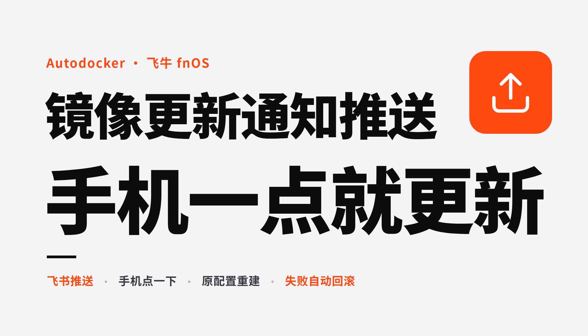
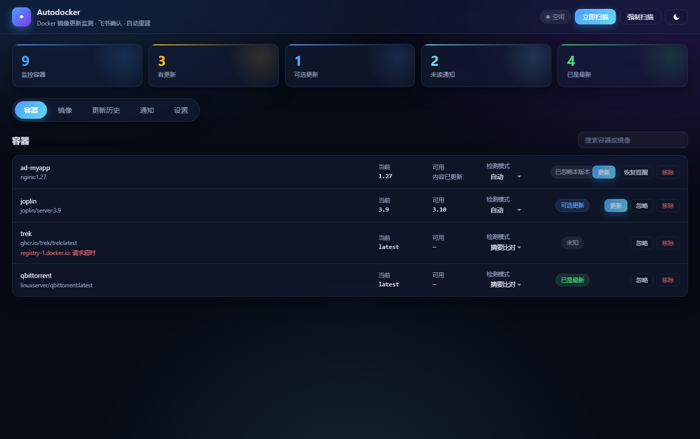
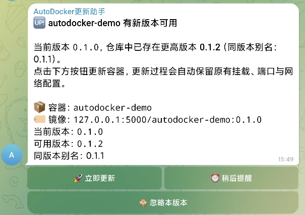

# AutoDocker

**Docker 镜像更新监测 · 飞书 / Telegram 确认 · 一键自动重建**

[](https://github.com/haihaipypy/autodocker/releases/latest)
[](https://hub.docker.com/r/haihaipypy/autodocker)
[](LICENSE)
[](go.mod)

监测本机容器的镜像有没有新版本，推送到飞书或 Telegram。在聊天里点「立即更新」，服务按原配置重建容器，
挂载、端口、网络、环境变量全部保留，失败自动回滚。没人用的镜像也能一键清理。



---

## 它解决什么问题

| 场景 | 传统做法 | AutoDocker |
| --- | --- | --- |
| 想知道镜像有没有更新 | 手动 `docker pull` 比对，或装个全自动更新的又不放心 | 定时巡检，发现更新推送到飞书 / Telegram |
| 决定要不要更新 | 登录 NAS / SSH 上去点 | 在聊天消息里点「立即更新」 |
| 更新容器 | 手写 `docker run`，容易漏掉挂载或环境变量 | 按原配置重建，字段零丢失 |
| 更新把服务搞挂了 | 手动找回原配置重新起 | 健康检查不通过自动回滚 |
| 磁盘被旧镜像占满 | 一个个 `docker rmi`，还怕删错正在用的 | 标明使用状态，一键清理未使用的 |

## 特性

- **通知渠道可选**：飞书（企业自建应用，长连接收回调）与 Telegram（bot 长轮询），
  填好凭据的渠道都会收到提醒，可以同时用两个。设置页左栏选渠道，右栏是所选渠道的完整配置流程。
- **容器与镜像分开管理**：容器页看「在跑的东西要不要更新」，镜像页看「磁盘上有什么、能不能清」。
- **两种检测模式自动判定**：浮动 tag 比摘要；版本号 tag 额外巡检 tag 列表，出现更高版本时提示。
- **按钮按状态渲染**，不摆灰按钮；检测失败的原因直接写在容器名下方。
- **两个忽略粒度**：卡片上「忽略本版本」只放行这一次远端内容，作者推了新版本照常提醒；
  容器页「忽略」是整条监控项不再检测。
- **深浅主题可切换**，默认深色。
- **聊天里点按钮后页面自动刷新结果**。

## 安装

三种方式任选。

### 1. 飞牛 fnOS 应用包

从 [Releases](https://github.com/haihaipypy/autodocker/releases/latest) 下载 `Autodocker.fpk`，
应用中心 → 手动安装 → 选中它。

装完桌面出现「Docker 更新助手」，也可直接访问 `http://<NAS_IP>:19999`。

→ [飞牛安装与排障](docs/install-fnos.md)：自己打包、ARM 机型、运行身份

### 2. Docker Compose（推荐）

在任意目录建一个 `docker-compose.yml`：

```yaml
services:
  autodocker:
    container_name: autodocker
    image: haihaipypy/autodocker:latest
    restart: unless-stopped
    ports:
      - "17777:17777"
    volumes:
      - /var/run/docker.sock:/var/run/docker.sock
      - ./data:/data
    environment:
      - TZ=Asia/Shanghai
      - PORT=17777
      - SELF_CONTAINER=autodocker
```

```bash
docker compose up -d
```

打开 `http://<IP>:17777`。需要飞书通知就进「设置」里填凭据。

仓库根目录的 `docker-compose.yml` 是同一份，带全部环境变量注释。

→ [Docker / Compose 部署与全部环境变量](docs/install-docker.md)

### 3. docker run

```bash
docker run -d --name autodocker --restart unless-stopped \
  -p 17777:17777 \
  -v /var/run/docker.sock:/var/run/docker.sock \
  -v "$PWD/data:/data" \
  -e TZ=Asia/Shanghai -e SELF_CONTAINER=autodocker \
  haihaipypy/autodocker:latest
```

要密码就加 `-e ADMIN_PASSWORD='你的密码'`。换端口要把宿主机端口和容器内 `PORT` 一起改，
比如 `-p 18000:18000 -e PORT=18000`。

Docker Hub 拉不动时换 GHCR：`ghcr.io/haihaipypy/autodocker:latest`，内容一致。

镜像为 `linux/amd64` / `linux/arm64` 双架构。升级：`docker compose pull && docker compose up -d`。

## 使用



定时巡检 → 发现新版本推送到飞书 / Telegram → 点「立即更新」→ 拉镜像、按原配置重建、健康检查
→ 通过则删旧容器，不通过自动回滚。

「可用」列写的是仓库里更高的版本号；没有更高版本号但同一 tag 被重新推送过，写「内容已更新」。

→ [完整使用说明](docs/usage.md)：两个列表的边界、忽略粒度、检测模式、清理策略

## 通知配置

两个渠道任选其一，都在「设置 → 通知渠道」里配。

### 飞书

**必须是企业自建应用。群自定义机器人（webhook）收不到按钮点击。**

六步：建应用 → 开机器人能力 → 申请 `im:message:send_as_bot`（应用身份）→
在「**回调配置**」标签页用长连接订阅 `card.action.trigger` → **发布新版本** →
把机器人拉进群，最后在设置页填 App ID / Secret / chat_id。

两个容易漏的点：回调加在旁边的「事件配置」里不生效；权限或回调改完不发布新版本，
点按钮报 `200340`，但卡片照收。

→ [飞书配置逐图步骤](docs/feishu.md)

### Telegram

五步：`@BotFather` 发 `/newbot` 拿 Token → 填进设置页**先保存一次** →
把 bot 拉进群并 **`@它` 说句话**（或直接私聊它发一条）→ 点「读取会话」，点一下会话即填入并保存 →
发送测试消息并**真的点一下**按钮。

三个容易漏的点：Token 不保存服务就不会开始长轮询，读不到会话 ID；
bot 默认读不到群里的普通聊天（成员列表写「无权读取消息」），得 `@它` 或关掉隐私模式；
这个 bot 若在别处设过 webhook 就收不到长轮询结果（两者互斥）。

> 国内直连 `api.telegram.org` 多半不通，「读不到会话」十有八九是这原因。
> 设置页有 **「检测连通性」**，不通时填**代理地址**（`192.168.1.2:7890` 或 `socks5://…`）或**API 地址**（自建反代）。

收到提醒时长这样，点按钮直接重建，不用回网页：



→ [Telegram 配置全流程](docs/telegram.md)

## 安全

- 挂载 `/var/run/docker.sock` 等同于宿主机 root 权限，只在可信内网使用。
- 访问密码默认空即不启用登录。要让端口离开内网，务必在「设置」里配上密码。
- 服务会拒绝更新自身，也会拒绝更新带 `--rm` 的容器。

→ [安全须知与已知边界](docs/faq.md)

## 技术简述

- 纯 Go 单二进制，前端零构建（`go:embed`），SQLite 用 `modernc.org/sqlite`（免 CGO）。
- 不依赖 Docker 官方 SDK，直接封装 Engine REST API，`HostConfig` 原样透传。
- 飞书走 WebSocket 长连接收回调，Telegram 走 bot 长轮询 —— 两者都免公网、免备案、免反向代理。
- 注册表加速三层兜底：用户设置 → 守护进程 `registry-mirrors` → 内置默认，只作用于 Docker Hub。

→ [技术实现与目录结构](docs/architecture.md)

## 许可与致谢

MIT，见 [LICENSE](LICENSE)。

本项目为独立实现，`go.mod` 只依赖飞书 SDK 与纯 Go SQLite 驱动，业务代码全部自研。
[vigil](https://github.com/jingyuan9527/vigil) 与
[dockerCopilot](https://github.com/onlyLTY/dockerCopilot)（均 AGPL-3.0）仅作思路参考，未复制其代码。

## 文档索引

| 文档 | 内容 |
| --- | --- |
| [install-fnos.md](docs/install-fnos.md) | 飞牛应用打包、安装、运行身份、排障 |
| [install-docker.md](docs/install-docker.md) | Docker / Compose 部署、全部环境变量、本地开发 |
| [feishu.md](docs/feishu.md) | 飞书自建应用配置全流程（含截图） |
| [telegram.md](docs/telegram.md) | Telegram bot 配置全流程、收不到消息的排查 |
| [usage.md](docs/usage.md) | 两个列表的边界、忽略粒度、检测模式、界面 |
| [architecture.md](docs/architecture.md) | 技术选型、重建保真规则、存储坑位、测试 |
| [faq.md](docs/faq.md) | 安全须知、已知边界、常见故障排查 |
| [release.md](docs/release.md) | 版本号、CI、Docker Hub / GHCR、Release 上传 |

---

作者：**无辣** · [blog.1day.vip](https://blog.1day.vip)
