# 飞书配置

> 返回 [README](../README.md)

**必须创建企业自建应用，群自定义机器人（webhook）不行** —— 自定义机器人只能单向发消息，收不到按钮点击。

整条配置**六步**，第 4 步和第 5 步是最容易漏的。

## 1. 创建应用

1. 打开 [飞书开放平台](https://open.feishu.cn/app) → 创建企业自建应用
2. 记下 **App ID** 和 **App Secret**

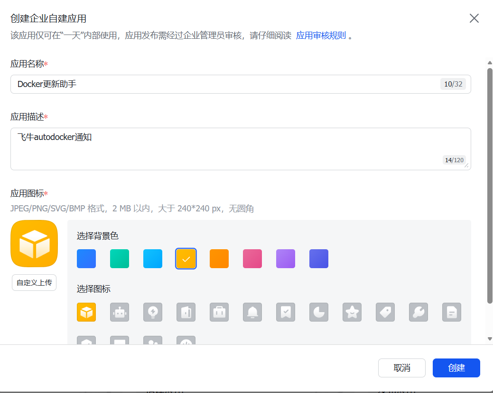

「凭证与基础信息」页里就是这两项：

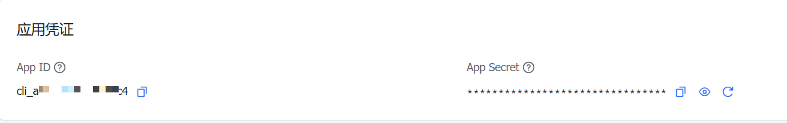

## 2. 开启机器人能力

「添加应用能力」→ 启用 **机器人**。

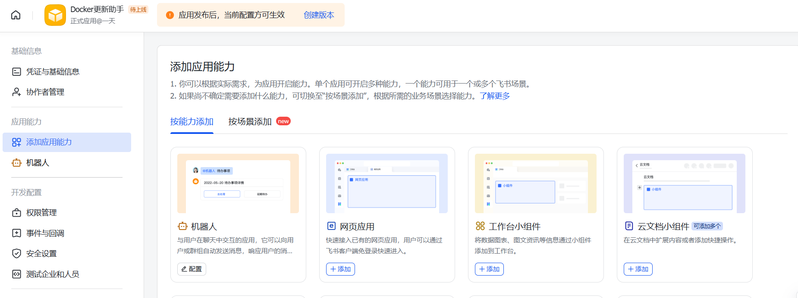

## 3. 申请权限

「开发配置」→「权限管理」→「API 权限」，搜索并开通下面两项，
**权限类型都选「应用身份」（tenant_access_token），不要选用户身份**：

- `im:message:send_as_bot` —— 以应用身份发消息、更新卡片（必需）
- `im:chat:readonly` —— 读取机器人所在的群列表，用来核对 chat_id（建议开）

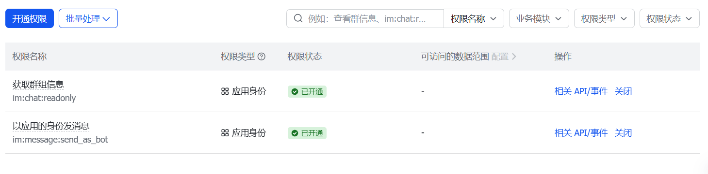

## 4. 订阅卡片回调（最容易配错的一步）

先回到「应用能力 → 机器人」的配置页，确认 **「消息卡片」开关是打开的**。
这个开关关着时，卡片照样能正常发出去，但点按钮毫无反应、也不报错 —— 最难排查的一种状态。

然后进「开发配置」→「事件与回调」，**切到「回调配置」标签页**：

> ⚠️ 卡片按钮点击属于**回调**，不属于**事件**。加到旁边的「事件配置」里完全不生效。
> 这两个标签页紧挨着，很多人在这里白折腾一晚上。

1. 「订阅方式」选 **「使用长连接接收回调」**，点保存。
   若提示「请先建立连接」，是因为本服务还没开始跑长连接 ——
   先把凭据填进应用并保存，再回来点一次保存即可。
2. 「已订阅的回调」→ 添加回调 → 搜 **「卡片回传交互」**（`card.action.trigger`）→ 确认添加。

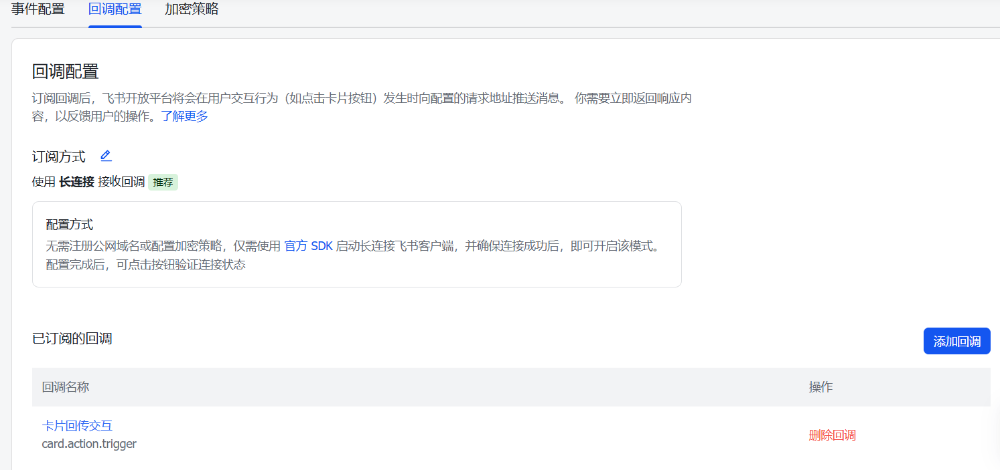

> 长连接模式**不需要公网地址、不需要备案域名、不需要反向代理**，容器只要能出网就能收到按钮点击。
> 注意旧版的「消息卡片回传交互」回调不支持长连接，只能把请求发到你的公网服务器；
> 本项目用的是**卡片 2.0**（`schema: 2.0` + 按钮 `behaviors.callback`），走 `card.action.trigger`，所以可以免公网。

## 5. 发布应用（不发布等于没配）

「应用发布」→「版本管理与发布」→ 创建版本 → 申请发布。企业内自建应用通常由管理员直接通过。

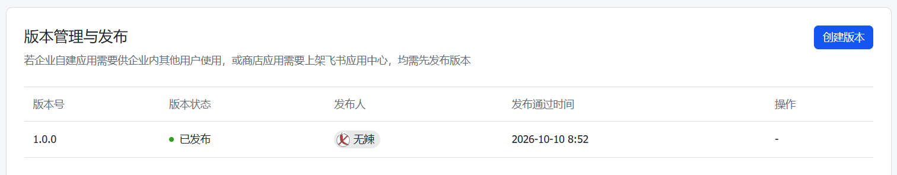

> **权限和回调改完，必须发布新版本才会生效。** 没发布时点卡片按钮会报错 `200340`
> （提示未配置卡片回调），可卡片本身收得到 —— 这个现象很误导人。

## 6. 把机器人拉进群

在飞书里新建（或复用）一个群 → 群设置 → 群机器人 → 添加机器人 → 选你刚建的应用。

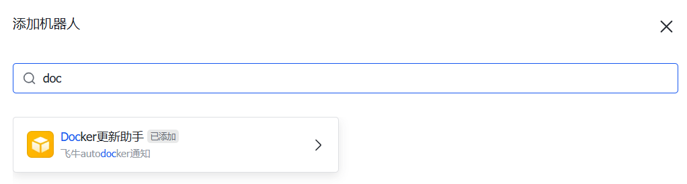

chat_id 形如 `oc_xxxxxxxxxxxxxxxx`，可用开放平台「API 调试台」的
`获取用户或机器人所在的群列表` 接口查询。

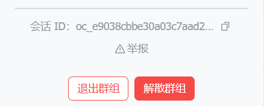

## 7. 填进应用里

拿到 **App ID / App Secret / chat_id** 后，打开应用 → **设置** → 「飞书通知」，
三项填进去点保存即可，**不需要重启**：

- 保存后凭据会写入本机数据库，卡片回调的长连接会自动（重）建立；
- 设置页会显示当前状态：未配置 / 已配置且长连接正常 / 已配置但长连接未就绪；
- 三项一并留空就能完全关闭飞书通知，长连接也会一并停掉。

> 用 docker compose 部署时，`FEISHU_*` 环境变量仍然可用，作为**首次启动的初值**；
> 数据库里已保存的值优先。飞牛 fpk 安装则完全没有这一步，装完进页面填就行。

## 8. 测试必须真的点一下

保存后点「发送飞书测试卡片」，群里会收到一张**带按钮**的卡片。

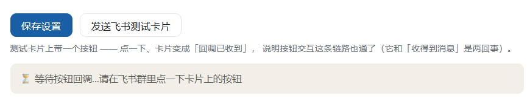
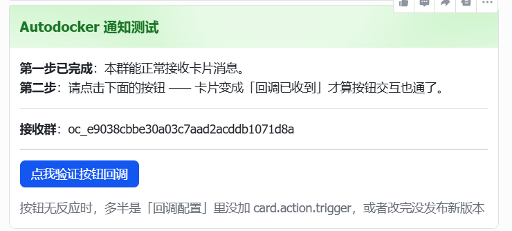

**点一下那个按钮** —— 卡片原地变成「回调已收到」，同时设置页上会出现
「✅ 已收到按钮回调」，才算整条链路打通。

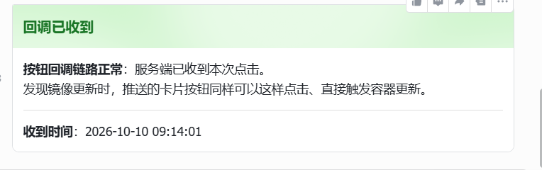
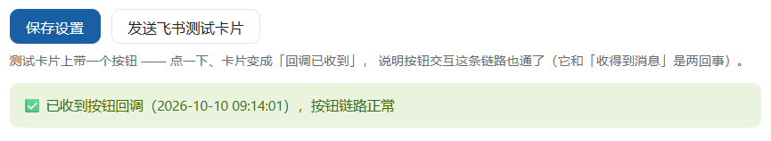

只确认「卡片收得到」是不够的：发消息走的是 `im/v1/messages`，
按钮点击走的是长连接回调，这是两条彼此独立的链路。现实里最常见的一类故障恰恰是
卡片正常显示、按钮点了毫无反应（多半是回调配置里没加 `card.action.trigger`，
或者改完权限/回调后没发布新版本）。所以测试卡片必须带按钮、并且要真的点一下。

设置页在 90 秒内一直等不到回调，会直接提示该去检查哪两处。

## 卡片长什么样

发现新版本时的提醒卡片：

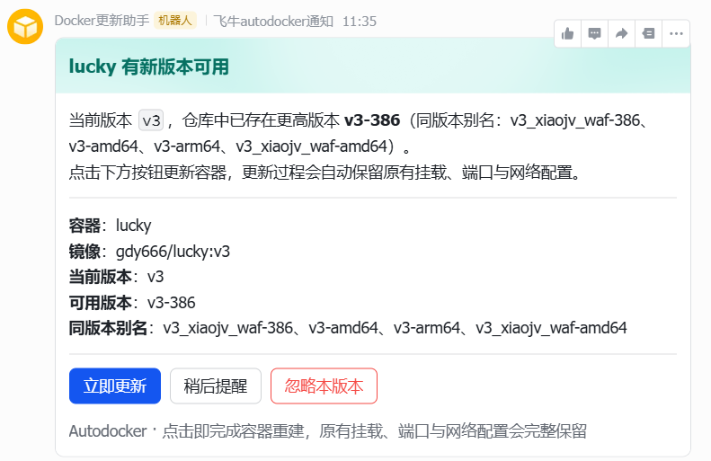

点击「立即更新」后原地变成进行中，完成后更新为结果：

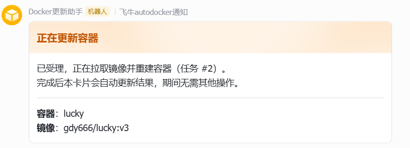
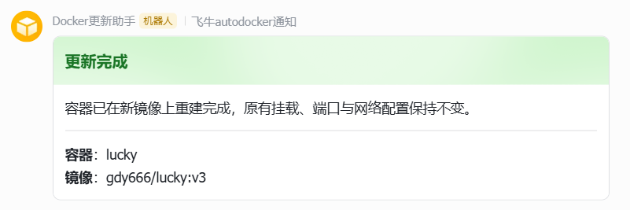

三个按钮分别是：**立即更新** / **稍后** / **忽略本版本**。
「忽略本版本」只放行这一次远端内容，作者推了新版本仍会照常通知 ——
两个「忽略」粒度的区别见 [使用方法](usage.md#两个忽略粒度)。
