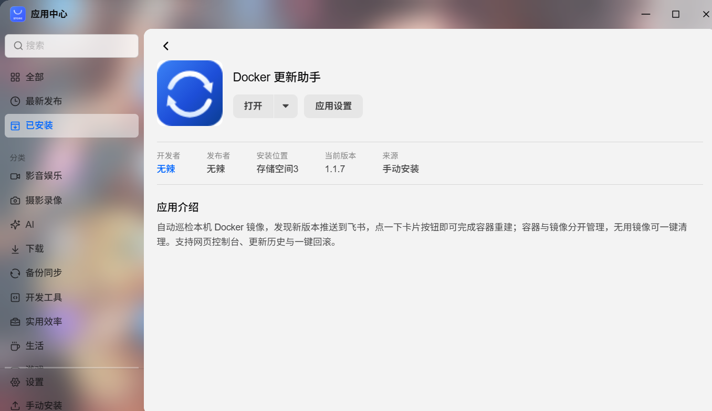

# 在飞牛 fnOS 上安装

> 返回 [README](../README.md) · 其他安装方式：[Docker / Compose](install-docker.md)

飞牛应用包（`.fpk`）是推荐方式：装完在飞牛桌面点图标就能用，不用记端口、不用写 compose。

前置条件：设备是飞牛 fnOS，且已经在应用中心装好 Docker。



## 一、打包

```bash
# 在本仓库目录下执行
./build-fpk.sh          # x86 设备
./build-fpk.sh arm64    # ARM 设备
```

产物是项目根目录下的 `Autodocker.fpk`。

脚本会依次做：交叉编译 → **校验 ELF 完整性** → 检查前端语法 → 规整行尾 → 调 `fnpack` 打包。

## 二、安装

任选一种：

```bash
# 命令行（在 NAS 上执行）
appcenter-cli install-fpk Autodocker.fpk
```

或者把 `.fpk` 传到 NAS，在**应用中心 → 手动安装**里选中它。

安装向导只问两件事：

| 向导项 | 说明 |
| --- | --- |
| 自动巡检间隔 | 默认 1 小时，也可选「关闭定时巡检」只手动扫描 |
| 镜像加速地址 | 可留空。留空时程序先沿用 Docker 守护进程已配的加速器，仍为空则使用内置默认 `docker.1ms.run,docker.xuanyuan.me`；要自己指定就填这里，多个地址用逗号分隔、按顺序回退 |

> **为什么要单独配一次加速。** 本服务查镜像摘要是自己发 HTTP 请求，
> 不会继承 Docker 守护进程 `daemon.json` 里的 `registry-mirrors`；
> 国内直连 `registry-1.docker.io` 基本不通，不配加速就会是一整列「未知」。
> 所以默认值走「显式配置 → 守护进程 → 内置默认」这条链，开箱即用，不必先配。

> **飞书配置不在安装向导里问**，装完打开应用、进「设置」标签页填即可 ——
> 凭什么要用的时候才去申请，而安装那一刻手上未必有。
> 保存后即时生效，连长连接都会自动重建，不需要重启应用。

装好后桌面会出现「Docker 更新助手」图标，点开即可；也可以直接在浏览器访问
`http://<NAS_IP>:19999`。

**默认不启用登录**，打开就能用 —— 装在自己 NAS 上，每次进去都要求输密码只会碍事。
需要加一道门、改巡检间隔，或调整镜像加速地址（设置页里有「检测注册表连通性」，
一键看清每个源通不通），都在应用内的「设置」标签页完成，保存即生效、不用重启。

## 三、运行身份

应用不是以容器方式运行的，而是以飞牛分配的专用低权限用户执行，再通过
`config/privilege` 里的 `join-groups: ["docker"]` 加入 `docker` 组来读写
`/var/run/docker.sock` —— 不需要 root。

## 四、排障

```bash
# 服务日志（卷号 N 视实际安装位置而定）
tail -f /vol{N}/@appdata/Autodocker/autodocker.log

# 运行状态：0 = 运行中，3 = 未运行
/var/apps/Autodocker/cmd/main status; echo $?

# 启动 / 停止
/var/apps/Autodocker/cmd/main start
/var/apps/Autodocker/cmd/main stop
```

看不到容器列表时，先确认 `autodocker` 用户能读 socket：

```bash
sudo -u autodocker test -r /var/run/docker.sock && echo 可读 || echo 不可读
```

不可读就把 `/etc/group` 里 `docker` 组的成员补上，或把 `fnos/config/privilege`
改成 `{"defaults":{"run-as":"root"}}` 后重新打包。

## 五、端口为什么不能改

端口 `19999` 在三个地方各写了一遍，改端口必须三处同步：

- `fnos/manifest` 的 `service_port`
- `fnos/app/ui/config` 的 `port`
- `fnos/app/bin/run.sh` 里的 `PORT` 默认值

飞牛的桌面入口是静态配置，不像某些平台支持 `${wizard_port}` 变量替换，
所以这里不在安装向导里开放端口设置 —— 否则用户在向导里改了端口，
Web 服务跑在新端口、入口还指着旧端口，页面必然打不开。

## 六、升级

把新版本的 `.fpk` 直接装一遍即可，`upgrade_callback` 会保留数据库与配置。
`config.env` 生成后不会被覆盖，所以**新增的配置项由升级脚本打补丁写入**，
不需要卸载重装。
