# Telegram 配置

> 返回 [README](../README.md)

和飞书一样：发现新版本推一条**带按钮**的消息，点按钮直接重建容器。
区别是 Telegram 不需要注册开放平台应用、不需要审核发布，三五分钟就能配完。

整条配置**五步**，第 2 步和第 3 步必须按顺序来（先保存，才能读到会话 ID）。

## 1. 创建 bot，拿 Token

在 Telegram 里搜索 `@BotFather`（认准官方认证的那一个），私聊它：

1. 发 `/newbot`
2. 按提示给它一个**显示名**（随便写，中文也行）
3. 再给它一个**用户名**，必须以 `bot` 结尾，例如 `my_autodocker_bot`

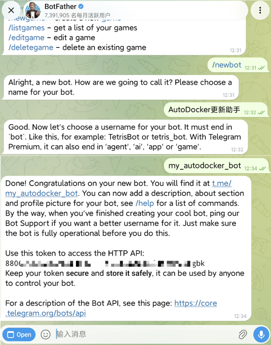

成功后 BotFather 会回一段：

```
Use this token to access the HTTP API:
123456789:AAHxxxxxxxxxxxxxxxxxxxxxxxxxxxxxxxxx
```

这串 `数字:字母数字` 就是 **Bot Token**，两段都不能少（包括中间的冒号）。

## 2. 先把 Token 填进去并保存

打开应用 → **设置** → 「通知渠道」选 **Telegram** → 把 Token 填到 **Bot Token** → 点页面底部「保存设置」。

> 这一步不能跳。服务只有在拿到 Token 之后才开始长轮询，
> 不保存就读不到后面要用的会话 ID。

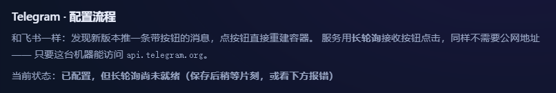

刚保存的那几秒可能显示「已配置，但长轮询尚未就绪」，等几秒会自己变成
「已配置，按钮回调长轮询运行中」。一直停在前一句，说明连不上官方 API，看第 5 步。

## 3. 让 bot 收到一条消息，再读会话 ID

服务靠「这个 bot 最近收到过谁的消息」来判断会话 ID，所以得先让它收到一条：

- **推到群里**：把 bot 拉进目标群（群设置 → 成员 → 添加成员，搜它的用户名），
  然后在群里 **`@你的bot用户名` 说一句话**（例如 `@my_autodocker_bot hi`）。
- **只自己收**：直接在 Telegram 里给 bot 发一条 `hi`。

搜用户名添加：

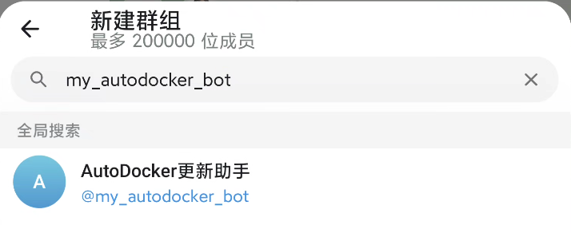

@ 它一句：

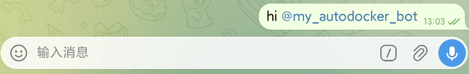

> ⚠️ **bot 默认读不到群里的普通聊天。** 成员列表里会写着「无权读取消息」，
> 此时群里别人说的话它一条也收不到，只认「@它」和「/命令」。
> 想让它在群里读到所有消息：找 `@BotFather` 发 `/setprivacy` → 选中这个 bot → `Disable`，
> 然后**把 bot 移出群、再重新拉进来**（Telegram 只在进群那一刻下发权限，不退群重进不生效）。
> 只是取个会话 ID 的话，@ 它一句就够了，不必改这个设置。

然后回到设置页点 **「读取会话」**，列表里会冒出刚才说话的会话 —— 点一下即自动填入
**接收会话 ID** 并保存，不用再点「保存设置」。

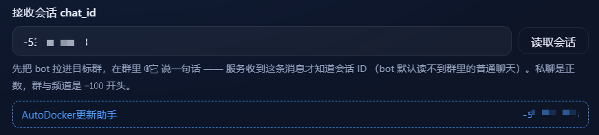

> 群与频道是 `-100` 开头的负数，私聊是正数。这是正常的，不是 bug。

## 4. 保存并发送测试消息

再点一次「保存设置」，然后点 **「发送测试消息」**。

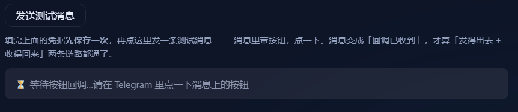

消息里带一个按钮，**点一下那个按钮**：

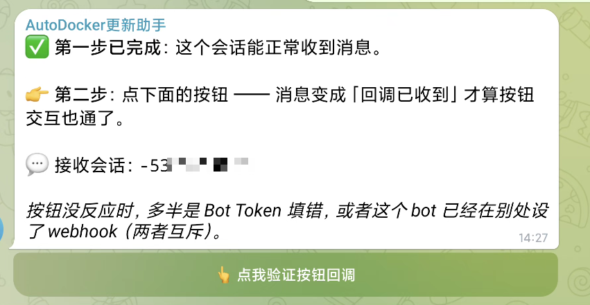

- 消息原地变成「✅ 按钮回调链路正常」
- 设置页出现「✅ 已收到按钮回调」

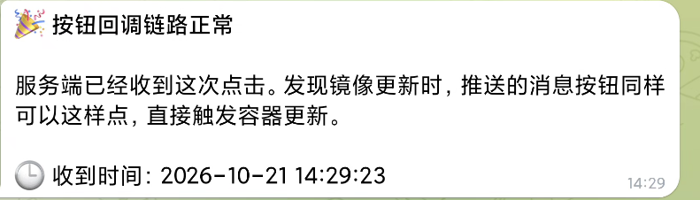

两条都成立才算链路打通。

只确认「消息收得到」是不够的：发消息走 `sendMessage`，按钮点击走长轮询的 `callback_query`，
这是两条彼此独立的链路。设置页 90 秒内等不到回调，会提示该检查哪两处。

## 5. 收不到消息时先查这几处

### 先点「检测连通性」

设置页 Telegram 区的「检测连通性」只做一件事：拿当前填的 Token 和代理去调一次 `getMe`。
通了会显示 `@你的bot`，**并且把这份配置自动保存**（长轮询立即按新代理重连），
不用再点一次「保存设置」；不通会直接给出原因。

它**不需要 chat_id**，所以能把你从「读不到会话 → 想发测试消息 → 提示没配会话」
这个循环里拉出来。

### 再按现象对号入座

1. **群里说普通聊天，bot 读不到** —— 成员列表里显示「无权读取消息」就是这回事。
   先 `@你的bot用户名` 说一句；要彻底放开就 `@BotFather` → `/setprivacy` → `Disable`，
   再**移出群重进**。
2. **Token 是否带全** —— 冒号前后都不能少，多一个空格也不行。
3. **这个 bot 是否在别处设过 webhook** —— webhook 与长轮询**互斥**，设过 webhook 就收不到轮询结果。
   在浏览器打开下面这个地址（把 `<TOKEN>` 换成你的 Token）确认：

   ```
   https://api.telegram.org/bot<TOKEN>/getWebhookInfo
   ```

   `"url"` 是空字符串才正常；不是空的就先删掉：

   ```
   https://api.telegram.org/bot<TOKEN>/deleteWebhook
   ```

4. **这台机器能不能访问 `api.telegram.org`** —— 国内网络环境常见直连不通，这是「读不到会话」最常见的原因。
   两条路，任选一条：
   - **走代理**：在 **代理地址** 里填 HTTP 代理（形如 `http://192.168.1.2:7890`），
     本机已有代理软件的话用它最省事。填完直接点 **「检测连通性」**，通了会自动保存。
   - **走反代**：在 **API 地址** 里填自建反代（形如 `https://tg.example.com`，不带 `/bot` 后缀），
     反代只需转发 `api.telegram.org` 的路径。

   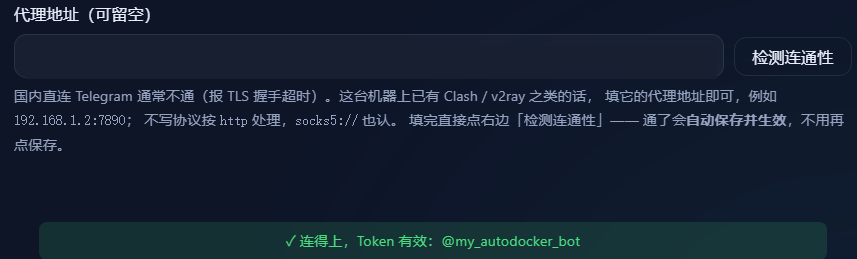

   > 代理地址写错（比如漏了 `http://`）会退回直连，不会让服务起不来。

## 可选：只让指定人点按钮

默认情况下，群里所有能看到这条消息的人都能点「立即更新」。
只是想给自己用的话，直接把 bot 私聊给自己（第 3 步选私聊会话），别拉进群。

## 消息长什么样

发现新版本时推过来的就是这样一张卡片：


点「🚀 立即更新」，卡片原地变成进度：

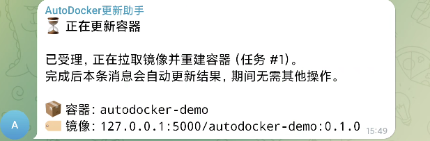

镜像拉完、容器重建完成，结果回到同一张卡片上：

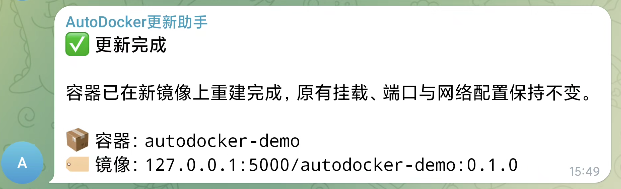

三个按钮的分工：

| 按钮 | 做什么 |
| --- | --- |
| 🚀 立即更新 | 拉新镜像并原地重建容器，完成后原地更新为结果 |
| ⏰ 稍后提醒 | 只是把消息标记为已读，下次巡检仍然会提醒 |
| 忽略本版本 | 只放行这一次远端内容，作者推了新版本仍会照常通知 |

两个「忽略」粒度的区别见 [使用方法](usage.md#两个忽略粒度)。

## 环境变量（Docker 部署可选）

用 docker compose 部署时，下面几项可以作为**首次启动的初值**，
数据库里已保存的值优先，配好之后改环境变量不会覆盖页面里的设置：

| 环境变量 | 说明 |
| --- | --- |
| `NOTIFY_CHANNEL` | 用哪个渠道，`telegram` 或 `feishu` |
| `TELEGRAM_BOT_TOKEN` | Bot Token |
| `TELEGRAM_CHAT_ID` | 接收会话 ID |
| `TELEGRAM_API_BASE` | API 地址，留空用官方 |
| `TELEGRAM_PROXY` | HTTP 代理，形如 `http://192.168.1.2:7890`，留空直连 |

飞牛 fpk 安装则完全没有这一步，装完进页面填就行。
